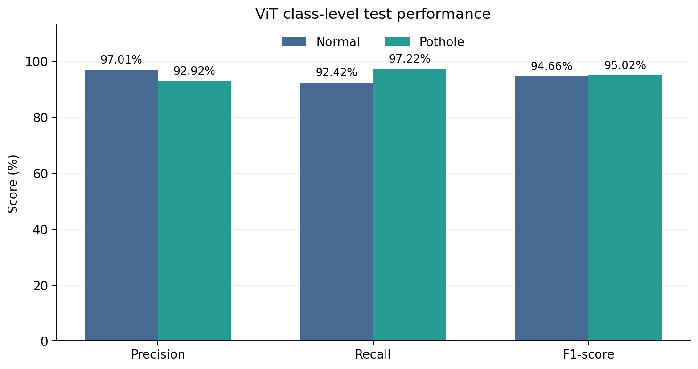
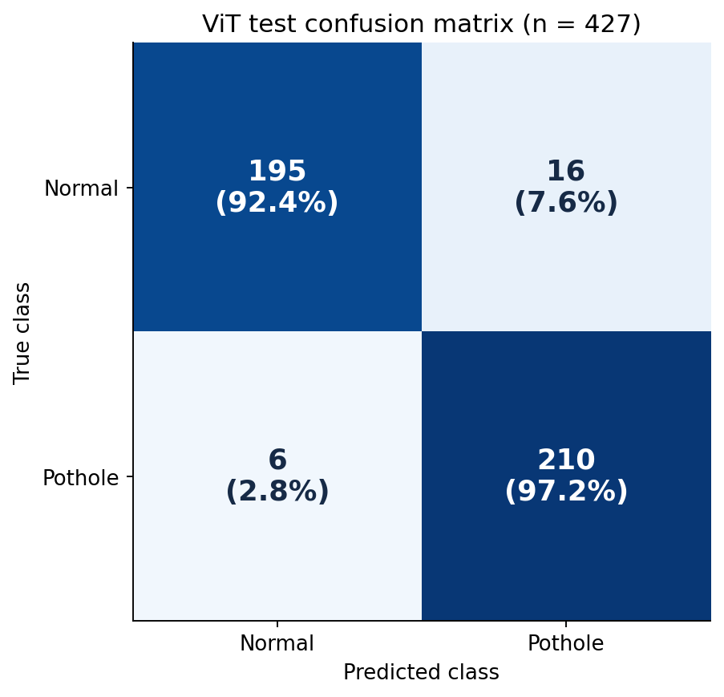
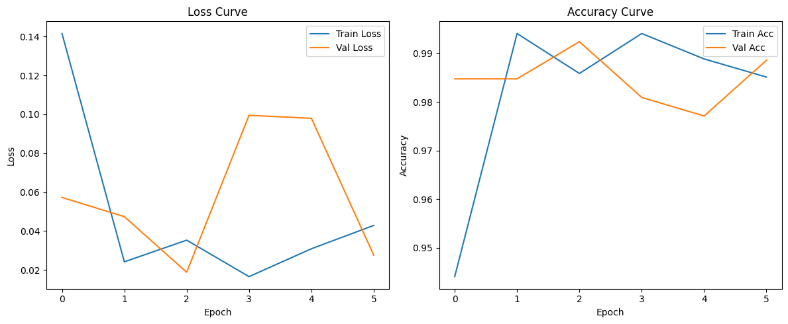

# Transformer-Based Pothole Detection

**Road-image classification with Vision Transformer, Swin Transformer and DenseNet121**

A computer vision research project for identifying potholes from road images or cropped road regions. The task is binary image classification (normal vs. pothole), not bounding-box detection or segmentation. ViT has recorded test results; the Swin and DenseNet121 implementations are provided for further experiments.

## Experimental results

| Model | Test accuracy | Macro F1 | Pothole recall | Status |
|---|---:|---:|---:|---|
| ViT Base / Patch16 | 94.85% | 94.84% | 97.22% | Recorded test |
| Swin Tiny | — | — | — | Test results not verified |
| DenseNet121 | — | — | — | Test results not verified |

ViT correctly classified **405 of 427** test images, including **210 of 216** pothole images. The recorded test loss was 0.1843. Six pothole images were missed and 16 normal images were falsely classified as potholes.





The confusion matrix is reconstructed from the original classification report's class supports and recalls. The chart and test CSVs preserve the recorded metrics; they are not new measurements.

## Training and dataset

| Split | Images |
|---|---:|
| Training | 1,342 |
| Validation | 262 |
| Test | 427 |
| Total | 2,031 |

ViT configuration: `vit_base_patch16_224`, pretrained initialization, 224 × 224 images, batch size 32, AdamW (learning rate and weight decay 1e-4), ReduceLROnPlateau scheduler, maximum 15 epochs, early-stopping patience 3. The recorded run stopped after epoch 6, selecting epoch 3 by validation loss (0.0188; validation accuracy 99.24%).



The training curves are extracted directly from the saved original notebook. The per-epoch values are available in [results/vit_training_history.csv](results/vit_training_history.csv). The lower test accuracy compared with validation accuracy warrants further investigation of generalization and dataset split independence.

## Repository structure

```text
assets/                 Training and test visualizations
notebooks/workflow.ipynb  Notebook entry point
results/                Historical experiment metrics (CSV)
src/classify.py          Training and evaluation CLI
src/prepare_dataset.py   Optional crop preparation
requirements.txt        Python dependencies
```

## Getting started

Python 3.10+ with compatible PyTorch and torchvision; CUDA is recommended for training.

```bash
python -m pip install -r requirements.txt
```

Provide authorized local copies of the dataset and checkpoint:

```text
data/PotholeProjectv2/
  train/normal/   train/pothole/
  val/normal/     val/pothole/
  test/normal/    test/pothole/
weights/best_vit_pothole.pth
```

### Evaluate the existing ViT checkpoint

```bash
python src/classify.py evaluate --model vit --data data/PotholeProjectv2 --weights weights/best_vit_pothole.pth --out runs/vit
```

### Train models (optional)

```bash
python src/classify.py train --model vit --data data/PotholeProjectv2 --weights weights/vit_new.pth --out runs/vit_new
python src/classify.py train --model swin --data data/PotholeProjectv2 --weights weights/swin_new.pth --out runs/swin
python src/classify.py train --model densenet121 --data data/PotholeProjectv2 --weights weights/densenet_new.pth --out runs/densenet
```

Optional crop preparation for labeled train/val source images:

```bash
python src/prepare_dataset.py --data data/crop --out data/cropped
```

The crop script expects `normal`, `pothole`, `normal labels`, `pothole labels` directories in each split. It does not generate a test split.

## Reproducibility and limitations

- Results are historical notebook measurements, not a fresh execution of the refactored CLI.
- The original dataset, checkpoint and sample photographs are not redistributed; verify usage rights before publication.
- Swin and DenseNet121 metrics are not claimed until completed experiments are verified.
- Dependency versions were not pinned in the original notebooks. Python syntax and notebook structure were checked; end-to-end checkpoint execution was not performed.
- This is an experimental image classifier, not a certified road-safety product. Localization and real-world road deployment require further validation.
- No open-source license is assigned without the author's approval.
